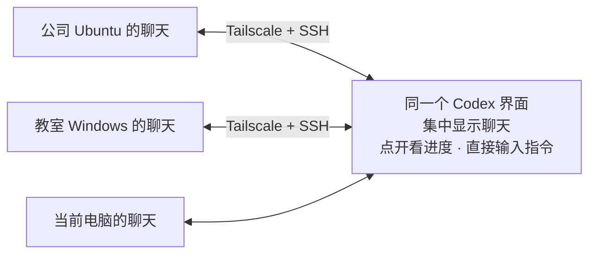

# 多机 Codex 协同

**把多台电脑的 Codex 聊天放在一起，直接看进度、下指令。**

公司电脑跑着任务，教室电脑处理着资料。回到家，打开眼前的 Codex，就能查看这些聊天的进度，在原对话中继续输入。

通过 **Tailscale** 连通各台电脑，再用 **SSH** 接入 Codex。下面是完整配置步骤，也可以安装配套 [Skill](SKILL.md)，让 Codex 帮你完成接入和排障。

## 连好以后怎么用

在当前 Codex 的侧边栏／聊天列表里，可以找到本机和已接入电脑上的聊天：

1. **看进度：** 点开公司电脑上的聊天，查看记录、当前状态和最新输出。
2. **下指令：** 直接在原聊天的输入框中补充要求、回答问题或安排下一步。
3. **换台电脑：** 点开教室电脑上的另一条聊天，接着处理那边的工作。

任务在各自的电脑上运行，文件留在原来的位置。



第一次先接入一台电脑，例如“个人电脑 → 公司电脑”。确认远端聊天能显示、能继续，再添加其他电脑。换一台电脑作为控制端时，在那台电脑上配置相应连接。

## 第一步：加入同一个 Tailscale 网络

**在哪操作：每台需要参与的电脑。**

Windows 从 [Tailscale 官网](https://tailscale.com/download/windows)下载安装，打开后登录。自己的几台电脑使用同一个 Tailscale 账号最省事；团队设备则由管理员授权加入同一网络。

Ubuntu 还没安装时，可以使用[官方安装方式](https://tailscale.com/docs/install/linux)：

```bash
curl -fsSL https://tailscale.com/install.sh | sh
sudo tailscale up
```

打开终端给出的链接完成登录。已安装并登录的电脑跳过这一步。

然后在每台电脑的终端或 PowerShell 中运行：

```text
tailscale ip -4
tailscale status
whoami
```

**电脑名称、登录用户名和 SSH 别名要分清。** 例如 Windows 的 `whoami` 显示 `MY-PC\alice`，登录用户名应填 `alice`。把每台电脑的信息记下来：

| 用来做什么 | SSH 别名 | Tailscale 地址 | SSH 登录用户 |
| --- | --- | --- | --- |
| 公司电脑跑任务 | company | 公司电脑实际的 100.x 地址 | Ubuntu 的 whoami 输出 |
| 教室电脑接着工作 | classroom | 教室电脑实际的 100.x 地址 | Windows 的本地账户名 |
| 个人电脑也作为执行端 | personal | 个人电脑实际的 100.x 地址 | 个人电脑的账户名 |

**验证连接：** 在控制端把占位内容换成目标电脑的地址，再运行：

```text
tailscale ping --c 5 <目标电脑的Tailscale地址>
tailscale ping --tsmp --c 5 <目标电脑的Tailscale地址>
```

以实际收到回包为准。`via DERP(...)` 表示通过中转连接，可以正常使用。

## 第二步：配置并验证 SSH 登录

**在哪操作：目标电脑开 SSH 服务，当前电脑配置登录。**

Tailscale 提供网络，OpenSSH 提供远程登录。本教程使用“普通 OpenSSH 走 Tailscale 地址”，不需要额外启用 Tailscale SSH 功能。

按目标系统完成 [SSH 配置](references/ssh-setup.md)：开启服务、添加公钥、配置别名并核对指纹。已有配置直接检查。

完成后，在当前电脑运行：

```text
ssh company whoami
ssh classroom whoami
```

只测试已配置的目标。返回的用户名应属于远端电脑，例如 Windows 会显示 `机器名\用户名`。

**需要双向连接时：** 在另一台电脑上按相同步骤配置反方向。各台电脑保留自己的私钥，只把公钥添加到目标账户。

## 第三步：确认远端的 Codex 能在 SSH 里运行

**在哪操作：先在目标电脑准备，再从当前电脑验证。**

目标电脑已经能用 Codex，就先检查现有安装。还没有 CLI 时，按 [Codex 官方安装说明](https://developers.openai.com/codex/cli/)安装；已有 Node.js／npm 的环境也可以执行：

```text
npm install -g @openai/codex
```

在目标电脑用准备接受 SSH 登录的那个账户运行：

```text
codex --version
codex login status
```

新安装需要登录时，在目标电脑本机完成。原本使用 API 或自定义服务商的，保留原来的配置，不因为连接另一台电脑而换一套认证。

再回到当前电脑：

```text
ssh company "codex --version"
ssh classroom "codex --version"
```

只检查已配置的目标。SSH 中找不到 codex 时，检查远端 PATH；Windows 可运行 `ssh classroom "where.exe codex"`。

## 第四步：在 Codex 中接入远端聊天

**在哪操作：你眼前这台电脑的 Codex 桌面客户端。**

1. 打开 **Settings → Connections（设置 → 连接）**，找到 SSH 主机。
2. 添加或启用前面配置的 company、classroom 等别名，等待连接成功。
3. 需要添加远程项目时，选择目标电脑上真实存在的目录，例如 Ubuntu 的项目目录，或 Windows 的 `C:\Users\账户\Documents\项目`。
4. 回到侧边栏／聊天列表，找到这台远端电脑上的已有聊天，点开一条熟悉的，确认能看到它原来的记录和当前状态。
5. 按同样方法加入其他电脑。它们的聊天也会出现在当前客户端中，你可以在这些聊天之间直接切换。

**确认远端聊天已经显示，并且能点开阅读。** 通过主机或运行位置标识区分电脑。不同版本的布局可能不同，连接入口见 [官方说明](https://learn.chatgpt.com/docs/remote-connections#connect-to-an-ssh-host)。

如果终端 SSH 已经成功，而 Codex 仍显示连接失败，请看 [SSH 好了，Codex 还连不上](references/remote-computers.md#ssh-好了codex-还连不上)。若连接成功却找不到旧聊天，继续看下面的排查方法。

## 第五步：直接看进度，在原聊天里下指令

### 查看工作进度

在同一个聊天列表里，点开公司电脑正在运行的任务，查看当前状态、已有输出和后续回复。再点开教室电脑上的任务，就切换到了另一台电脑的工作。

同名聊天可以通过所属主机和项目区分。网络断开时，界面里保留的旧记录不代表最新进度，需要恢复连接后再查看。

### 在原聊天中继续下指令

打开要继续的聊天，直接在输入框中发送要求。对应电脑上的 Codex 会沿用这条对话的上下文继续处理，后续进度和结果也显示在这里。

### 在指定电脑上新建任务

选择目标电脑上的项目，确认主机和路径，再新建聊天、输入任务。要接着做已有任务，直接回到原聊天即可。

### 已经接入，为什么某些历史聊天没有显示？

先确认目标连接已启用，再检查侧边栏当前的主机、项目分组或筛选范围。接着核对 SSH 是否登录了原来使用 Codex 的系统用户，以及远端 Codex 服务使用的数据目录。Windows 用户改名后，个人目录可能仍是旧名称；不同账户或不同 `CODEX_HOME` 也可能读到不同历史。

聊天记录仍保存在各自的主机上。详细排查见 [让远端聊天显示出来](references/codex-chats.md)。

## 第六步：让远端电脑保持可用

远端电脑需要保持开机、联网和唤醒。离开前检查电源与睡眠设置，避免任务进行中无法访问。

Windows 如果希望注销后 Tailscale 仍在线，可在托盘图标的 **Preferences → Run unattended** 开启无人值守模式，具体见 [Tailscale 官方说明](https://tailscale.com/docs/how-to/run-unattended)。这只解决网络在线；Codex 的桌面、沙箱或某些 Windows 适配方式可能仍需要对应用户保持登录，要分别确认。

离开前从另一台电脑做一次完整检查：能登录 SSH、能打开远端聊天、能收到远端回复。短暂断网后先重连原来的主机、查看原聊天状态，再决定是否重试；不要直接把同一任务再发一遍。

## 安装和使用 Skill

在发起连接的电脑上安装，需先安装 Git。

Ubuntu／macOS：

```bash
mkdir -p "$HOME/.agents/skills"
git clone https://github.com/zn099/codex-workspace-management.git \
  "$HOME/.agents/skills/codex-workspace-management"
```

Windows PowerShell：

```powershell
$skillRoot = Join-Path $env:USERPROFILE '.agents\skills'
New-Item -ItemType Directory -Force $skillRoot | Out-Null
git clone https://github.com/zn099/codex-workspace-management.git (Join-Path $skillRoot 'codex-workspace-management')
```

已安装且没有本地修改时，在技能目录执行 `git pull --ff-only` 更新。安装位置见 [官方说明](https://learn.chatgpt.com/docs/build-skills#where-to-save-skills)。

安装后，在 Codex 新聊天中输入：

```text
$codex-workspace-management
我想让公司和教室电脑的 Codex 聊天一起显示在当前电脑的界面里，
能直接点开看工作进度，并在原聊天中继续输入指令。
请检查已有 Tailscale 和 SSH 配置，完成接入，并确认远端聊天可见。
需要我在另一台电脑操作的部分，请说清在哪台、做什么、成功后看到什么。
```

接入后，如果有聊天没有显示，也可以让 Skill 帮你排查：

```text
$codex-workspace-management
教室电脑的 SSH 已经连通，但它原来的聊天没有出现在当前 Codex 中。
请检查连接的用户、Codex 服务和聊天显示范围，修复后确认旧聊天能打开。
```

## 常见问题

| 现象 | 先看哪里 |
| --- | --- |
| Tailscale 在线，ping／SSH 却超时 | [在线不等于连得通](references/remote-computers.md#tailscale-在线为什么还是超时) |
| Windows 写公钥时拒绝访问 | [管理员 PowerShell 和公钥文件](references/ssh-setup.md#目标是-windows) |
| SSH 报 publickey 错误 | [用户名、密钥与授权](references/remote-computers.md#permission-denied-publickey) |
| SSH 可以，Codex 不行 | [远端启动环境](references/remote-computers.md#ssh-好了codex-还连不上) |
| 连上后找不到某条聊天 | 回到第五步，核对主机、账户、数据目录和客户端能力 |
| 时好时坏，一直重连失败 | [断线与重连](references/remote-computers.md#一会儿能连一会儿又断) |

[MIT License](LICENSE)
