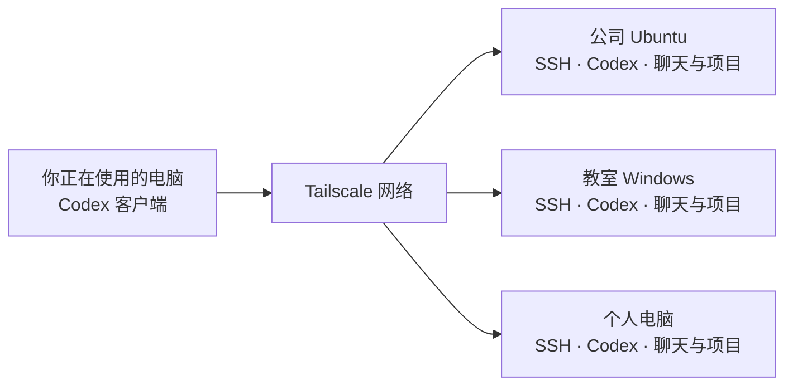

# 用 Tailscale 连通多台电脑，在 Codex 里查看和继续聊天

公司有一台性能不错的 Ubuntu，教室和宿舍各有一台 Windows。人在宿舍，却想看看公司电脑上的任务跑到哪里了，再给教室电脑上的那条聊天补一句要求。

这份教程就是为这件事写的：**先用 Tailscale 把几台电脑连起来，再通过 SSH 接入 Codex，最后在一个客户端里查看各台电脑的聊天、继续已有任务或下达新任务。**

仓库里有两样东西：下面这份可以照着走的教程，以及一个可以交给 Codex 使用的 [Skill](SKILL.md)。你可以自己配置，也可以装好 Skill 后让 Codex 帮你检查和操作。

## 先看一下，连好以后怎么用

你可以在当前电脑的 Codex 中提出这样的请求：

> 看看公司电脑和教室电脑最近的聊天，告诉我哪些还在运行。

> 打开教室电脑上“整理课程资料”那条聊天，我想接着聊。

> 给公司电脑上“训练模型”那条聊天追加要求：先告诉我当前进度，暂时不要启动新一轮训练。

这里的公司、教室是你给电脑起的连接名称。任务实际在哪台电脑执行，取决于那条聊天所在的主机；当前这台电脑负责显示进度和发送你的指令。



第一次先连通一个方向，例如“个人电脑 → 公司电脑”。跑通以后再加教室电脑。想反过来控制，就在反方向也配置一次；不用一开始就把所有组合都做完。

## 第一步：让几台电脑加入同一个 Tailscale 网络

**在哪操作：每台需要参与的电脑。**

Windows 从 [Tailscale 官网](https://tailscale.com/download/windows)下载安装，打开后登录。自己的几台电脑使用同一个 Tailscale 账号最省事；团队设备则由管理员授权加入同一网络。

Ubuntu 还没安装时，可以使用[官方安装方式](https://tailscale.com/docs/install/linux)：

```bash
curl -fsSL https://tailscale.com/install.sh | sh
sudo tailscale up
```

打开终端给出的登录链接，完成登录。已经安装并登录的机器直接往下走，不要为了照教程重新退出账号。

然后在每台电脑的终端或 PowerShell 中运行：

```text
tailscale ip -4
tailscale status
whoami
```

记下地址和用户名。这里最容易弄混的是：**电脑名称、登录用户名和 SSH 别名是三回事。** Windows 的 whoami 如果显示 `MY-PC\alice`，本地账户名就是 alice，不是 MY-PC。

可以给自己留这样一张表，实际内容留在自己的电脑上：

| 用来做什么 | SSH 别名 | Tailscale 地址 | SSH 登录用户 |
| --- | --- | --- | --- |
| 公司电脑跑任务 | company | 公司电脑实际的 100.x 地址 | Ubuntu 的 whoami 输出 |
| 教室电脑接着工作 | classroom | 教室电脑实际的 100.x 地址 | Windows 的本地账户名 |
| 个人电脑也作为执行端 | personal | 个人电脑实际的 100.x 地址 | 个人电脑的账户名 |

**怎么知道这一步成功了：** 在准备发起连接的电脑上，把下面的占位内容换成目标电脑地址再执行：

```text
tailscale ping --c 5 <目标电脑的Tailscale地址>
tailscale ping --tsmp --c 5 <目标电脑的Tailscale地址>
```

管理页面的绿点只说明设备有在线状态。这里要看是否实际收到回包。看到 `via DERP(...)` 表示用了中转，不等于失败；先把连接用起来，不必一开始追求直连。

## 第二步：先让 SSH 真正登录进去

**在哪操作：目标电脑开 SSH 服务，当前电脑配置登录。**

Tailscale 提供网络，OpenSSH 提供远程登录。本教程使用“普通 OpenSSH 走 Tailscale 地址”，不需要额外启用 Tailscale SSH 功能。

按目标系统照着 [SSH 配置步骤](references/ssh-setup.md) 做一次。里面分别写了 Ubuntu 和 Windows 的服务、公钥、指纹以及客户端别名，已经做好的步骤可以跳过。

完成后，在当前电脑运行：

```text
ssh company whoami
ssh classroom whoami
```

只测试你已经配置的目标。输出应是那台远端电脑的用户，例如 Windows 会显示 `机器名\用户名`。出现这个结果，才说明你真的登录到了目标机器。

**想建立反向连接：** 换到另一台电脑，按相同方法把原来的当前电脑作为目标。每台电脑保留自己的私钥，把公钥交给需要登录的目标；不用把私钥复制来复制去。

## 第三步：确认远端的 Codex 能在 SSH 里运行

**在哪操作：先在目标电脑准备，再从当前电脑验证。**

目标电脑已经能用 Codex，就先检查现有安装。还没有 CLI 时，按 [Codex 官方安装说明](https://developers.openai.com/codex/cli/)安装；已有 Node.js／npm 的环境也可以执行：

```text
npm install -g @openai/codex
```

在目标电脑用准备接受 SSH 登录的那个账户运行：

```text
codex --version
codex login status
```

新安装需要登录时，在目标电脑本机完成。原本使用 API 或自定义服务商的，保留原来的配置，不因为连接另一台电脑而换一套认证。

再回到当前电脑：

```text
ssh company "codex --version"
ssh classroom "codex --version"
```

只检查已配置的目标。**远端桌面能运行、SSH 中却说找不到 codex，通常要查 SSH 环境里的 PATH。** 不要先重装所有东西。Windows 可以进一步运行 `ssh classroom "where.exe codex"`。

## 第四步：把电脑加进 Codex

**在哪操作：你眼前这台电脑的 Codex 桌面客户端。**

1. 打开 **Settings → Connections（设置 → 连接）**，找到 SSH 主机。
2. 添加或启用前面配置的 company、classroom 等别名。
3. 等连接成功，选择目标电脑上真实存在的项目目录。这里选的是远端路径，例如 Ubuntu 的项目目录，或 Windows 的 `C:\Users\账户\Documents\项目`。
4. 在这个远程项目里先开一条测试聊天，只让它报告 `whoami`、当前路径和系统，不修改文件。

如果回答里是目标电脑的用户和路径，就可以在这台机器上安排工作了。其他电脑重复添加即可。[官方 SSH 接入说明](https://learn.chatgpt.com/docs/remote-connections#connect-to-an-ssh-host)描述了这条接入路径；不同版本的按钮文字可能略有区别。

如果终端 SSH 已经成功，而 Codex 仍显示连接失败，请看 [SSH 好了，Codex 还连不上](references/remote-computers.md#ssh-好了codex-还连不上)。Windows 的远端 shell、Codex 版本和启动环境需要单独核对，不能仅凭 SSH 成功就说整个接入完成。

## 第五步：开始管理不同电脑上的聊天

现在来到真正要用的部分。你不必每次先开远程桌面，再去那台电脑上找 Codex 窗口。

### 看看哪台电脑在忙

在支持跨主机聊天工具的 Codex 客户端里，可以直接说：

> 列出公司电脑和教室电脑最近的聊天，按电脑分开。保留原来的聊天标题，告诉我每条是在运行、已完成，还是等我回复。先只查看。

Codex 应从连接主机取得真实聊天列表。若当前版本只支持添加远程项目、没有跨主机聊天工具，就在界面中切换到对应主机或项目查看；Skill 不能凭空补出产品没有的功能。

### 继续一条已有聊天

最好同时说清楚**哪台电脑、哪条聊天**：

> 打开教室电脑的“整理课程资料”，先给我看它最近做到哪里了。

确认是目标聊天后，你可以直接在那条聊天继续输入，也可以明确让当前聊天代为发送：

> 给教室电脑的“整理课程资料”发送：继续整理第二章，沿用刚才确认的格式。

“看进度”和“发送任务”是两个动作。你只问进度时，应只读取；你明确说发送后，就把要求发到那条已有聊天。两台电脑有同名聊天时，先核对主机和项目，别发错。

### 在另一台电脑开新任务

> 在公司电脑的“演示项目”里新建一条聊天，帮我检查测试失败的原因。先运行现有测试，把结果告诉我。

这会创建一条新聊天。若你的意思是沿用前面讨论过的上下文，就选原来的聊天继续，不要另开一条后期待它自然记得全部内容。

### 为什么连上了，却看不到原来的聊天？

先检查连接是不是用了原来那个系统用户，以及它实际使用的 Codex 数据目录。Windows 用户改名后，个人目录可能还是旧名称；不同账户或不同 `CODEX_HOME` 也可能对应不同历史。

接着确认客户端当前打开的是正确的主机，且该版本确实能够列出那个远端服务里的聊天。**SSH 不会自动把几台电脑的聊天合并成一份，也不会单独接管另一个桌面进程。** 如果旧聊天没有出现在接入的服务里，要继续排查服务和数据目录，不能靠复制整个 `.codex` 文件夹解决。

## 第六步：离开电脑前，确认它能一直被找到

公司或教室的电脑需要开机、联网、保持唤醒。网络服务会开机启动，并不意味着睡眠中的电脑还能接任务。

Windows 如果希望注销后 Tailscale 仍在线，可在托盘图标的 **Preferences → Run unattended** 开启无人值守模式，具体见 [Tailscale 官方说明](https://tailscale.com/docs/how-to/run-unattended)。这只解决网络在线；Codex 的桌面、沙箱或某些 Windows 适配方式可能仍需要对应用户保持登录，要分别确认。

离开前从另一台电脑做一次完整检查：能登录 SSH、能打开远端聊天、能收到远端回复。短暂断网后先重连原来的主机、查看原聊天状态，再决定是否重试；不要直接把同一任务再发一遍。

## 不想自己逐项配置，就把 Skill 交给 Codex

Skill 的名字沿用仓库的 `codex-workspace-management`，界面显示为“Codex 多电脑聊天管理”。装在你准备用来管理其他电脑的那台机器上即可；换另一台机器来管理时，再在那台安装。

Ubuntu／macOS，需要 Git：

```bash
mkdir -p "$HOME/.agents/skills"
git clone https://github.com/zn099/codex-workspace-management.git \
  "$HOME/.agents/skills/codex-workspace-management"
```

Windows PowerShell，需要 Git：

```powershell
$skillRoot = Join-Path $env:USERPROFILE '.agents\skills'
New-Item -ItemType Directory -Force $skillRoot | Out-Null
git clone https://github.com/zn099/codex-workspace-management.git (Join-Path $skillRoot 'codex-workspace-management')
```

已经安装过就更新原目录，不再克隆一份。在没有未处理的本地修改时，可以进入技能目录执行 `git pull --ff-only`。技能发现方式见 [官方说明](https://learn.chatgpt.com/docs/build-skills#where-to-save-skills)。

接着在 Codex 新聊天中说：

```text
$codex-workspace-management
我想用当前电脑管理公司和教室电脑上的 Codex 聊天。
请先检查已有 Tailscale 和 SSH 配置，接着验证远端 Codex，
最后列出能访问的聊天。能直接做的步骤请完成，需要我在另一台
电脑操作的部分，请告诉我在哪台电脑、执行什么、怎样确认成功。
```

或者只让它做一件事：

```text
$codex-workspace-management
查看教室电脑“整理课程资料”的进度，先不要发新任务。
```

## 卡住了，从这几个地方找

| 现象 | 先看哪里 |
| --- | --- |
| Tailscale 在线，ping／SSH 却超时 | [在线不等于连得通](references/remote-computers.md#tailscale-在线为什么还是超时) |
| Windows 写公钥时拒绝访问 | [管理员 PowerShell 和公钥文件](references/ssh-setup.md#目标是-windows) |
| SSH 报 publickey 错误 | [用户名、密钥与授权](references/remote-computers.md#permission-denied-publickey) |
| SSH 可以，Codex 不行 | [远端启动环境](references/remote-computers.md#ssh-好了codex-还连不上) |
| 连上后找不到某条聊天 | 回到第五步，核对主机、账户、数据目录和客户端能力 |
| 时好时坏，一直重连失败 | [断线与重连](references/remote-computers.md#一会儿能连一会儿又断) |

本教程整理自 Ubuntu 与 Windows 多机联调。聊天管理能否使用，以当前客户端实际提供的功能为准；配置示例使用占位值，不包含个人设备、账号或密钥。社区项目，采用 [MIT 许可](LICENSE)。
