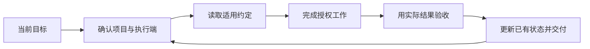

# Codex 统一工作法

**一个可安装的 Codex Skill，让项目有固定落点、任务有实际验收、跨电脑工作有清楚的交接。**

它把容易混在一起的项目约定、可复用流程、当前进度和特定聊天分开维护。适合同时使用多台电脑，或经常跨聊天继续科研、文档与代码项目的人。

这是社区方法库，与 OpenAI 无隶属关系。它提供工作指引和模板；不安装后台管理服务，也不自动同步电脑。

English: An instruction-based Codex skill for project organization, verified execution, multi-computer workflows, and explicit handoffs. Main documentation is in Chinese. The skill has no runtime dependencies; Git is used in the installation examples.

## 三分钟开始

将仓库安装到用户技能目录，文件夹名保持为 codex-workspace-management。路径若已存在，先检查内容，不覆盖安装。

Ubuntu／macOS：

```bash
mkdir -p "$HOME/.agents/skills"
git clone https://github.com/zn099/codex-workspace-management.git \
  "$HOME/.agents/skills/codex-workspace-management"
```

Windows PowerShell：

```powershell
$skillRoot = Join-Path $env:USERPROFILE '.agents\skills'
New-Item -ItemType Directory -Force $skillRoot | Out-Null
git clone https://github.com/zn099/codex-workspace-management.git (Join-Path $skillRoot 'codex-workspace-management')
```

仓库根目录就是技能目录。安装不会覆盖全局 AGENTS.md、SSH 配置或 Codex 认证。Codex 从 `~/.agents/skills` 发现技能，也支持技能目录链接；这是[官方说明](https://learn.chatgpt.com/docs/build-skills#where-to-save-skills)中的产品行为。

在新聊天中输入：

```text
$codex-workspace-management
请梳理当前项目的正式目录、执行设备、未完成任务和验收条件，
沿用现有规则继续工作。不要创建重复项目，也不要上传未授权内容。
```

技能默认允许按任务自动选择。列表未刷新时先在新聊天检查；必要时在方便的时机重开客户端，避免中断正在执行的任务。

## 它如何管理工作



| 要解决的事 | 做法 |
| --- | --- |
| 换一次聊天就新建一个目录 | 按项目内容复用固定根目录和成果路径 |
| 文件越来越多，分不清哪份最新 | 同一逻辑文件覆盖更新；独立实验和原始数据保持身份 |
| 远端在线但实际不能用 | 分别验证网络、SSH 身份、工具环境和应用操作 |
| 想在另一台电脑继续 | 选择固定执行端或 Git 工作副本，明确当前写入端 |
| 新聊天不知道前面做到了哪里 | 读取项目已验证结果、未解决项和下一步 |
| 修连接时改坏其他配置 | 按失败层做最小修复，保留既有账号和可用通道 |
| 为了统一管理上传了全部资料 | 按项目选择同步，公共方法和本机资料分开 |

目录组织默认采用 outputs/ 与 work/，新增文档主题不足三个文件时保持扁平。已有结构和使用者的明确选择优先；代码、技能、Git 及环境必需目录不受这个数量约定限制。

## 常用请求

**整理项目**

> 使用 $codex-workspace-management，查找这项工作已有的正式项目，统一成果路径，先检查引用再清理已经迁移完成的旧入口。

**跨电脑接续**

> 使用 $codex-workspace-management，我要在另一台电脑继续这个项目。先核对执行端、工作副本和同步选择，给出最短步骤并完成已授权部分。

**修复远程连接**

> 使用 $codex-workspace-management，远端 Tailscale 在线但 SSH 超时。先区分发现层、加密通道和 SSH 故障，保留现有远程通道；修复后报告持续测试结果。

**蒸馏经验**

> 使用 $codex-workspace-management，把这次已经验证且能复用的方法更新到适用的项目规则或技能。保留适用条件，不记录机器私密信息和未经验证的结论。

## 文件入口

- [SKILL.md](SKILL.md)：简短入口与流程选择。
- [项目执行](references/project-workflow.md)：目录、任务、纠错和验收。
- [交接与同步](references/handoff-and-sync.md)：状态、聊天边界、Git 与开源。
- [远程电脑](references/remote-computers.md)：Ubuntu／Windows、Tailscale／SSH 分层诊断。
- [AGENTS 模板](assets/AGENTS.template.md)：按需裁剪，合并时保留原规则。
- [验收场景](EVALUATION.md)：维护技能时检查行为是否符合目标。

## 适用边界

普通问答和单文件小修改不需要完整流程。专业科研结论、物理实验、机器人控制和文档排版仍需对应证据与专项能力。

SSH 可执行远端命令，但不会自动共享全部聊天记忆；查看或接续已有聊天需产品支持。CLI 可运行不等于桌面连接已验收。当前产品入口见 [OpenAI 远程连接文档](https://learn.chatgpt.com/docs/remote-connections)。

没有一种中转区域、自动重连或重启方法能解决所有连接问题。本仓库不提供针对个人环境的固定中转、Windows shell 补丁或认证替换脚本。

## 维护与贡献

只维护一份源文件。确认本地修改已妥善处理后可用 `git pull --ff-only` 更新；不要强制覆盖本地定制。另需正式项目入口时，可链接到同一目录而不复制技能。

贡献应来自实际需要或可复现问题：说明请求、观察结果、最小调整和验证。新增经验带适用条件，长流程放按需参考，避免扩成适用于所有事情的提示词集合。

维护时检查 [验收场景](EVALUATION.md)，并在有内置 skill-creator 的环境运行其 scripts/quick_validate.py。结构检查通过不代表真实网络或所有模型行为已测试。不要上传真实主机地址、密钥、登录文件、完整会话或业务数据。

采用 [MIT License](LICENSE)。
