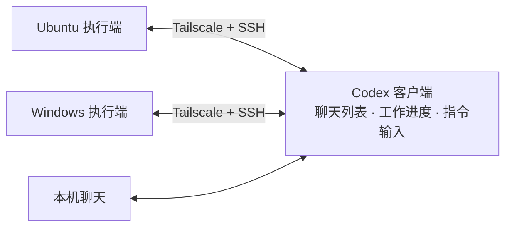

# Codex Multi-Machine Collaboration

**多机 Codex 协同工作：在一个界面中查看多台电脑的聊天、跟进任务并下达指令。**

通过 Tailscale 和 SSH 将 Ubuntu、Windows 电脑接入 Codex。远端聊天与本机聊天集中显示，打开原对话即可查看进度、补充要求；任务在各自的电脑上执行。

[快速开始](#快速开始) · [安装 Skill](#安装-skill) · [配置指南](references/setup.md) · [故障排查](references/remote-computers.md)

## 功能

- **集中查看聊天**：在同一 Codex 客户端中访问多台电脑的对话记录。
- **直接跟进任务**：点开远端聊天，查看运行状态、输出和结果。
- **继续原有对话**：在原聊天中发送后续指令，沿用已有上下文。
- **跨系统接入**：提供 Ubuntu 与 Windows 的 Tailscale、SSH 配置步骤和排障方法。



## 快速开始

需要支持 SSH 连接与远端聊天的 Codex 客户端。执行端应保持开机、联网，并已安装和登录 Codex CLI。首次配置 Tailscale、公钥或 SSH 服务时，先完成 [配置指南](references/setup.md)。

### 1. 验证远端连接

在控制端运行，将 `company` 替换为已配置的 SSH 别名：

```text
ssh company whoami
ssh company "codex --version"
```

确认返回执行端的用户和 Codex 版本。

### 2. 接入 Codex

1. 打开 **Settings → Connections（设置 → 连接）**，启用目标 SSH 主机。
2. 按需选择执行端的项目目录。
3. 返回聊天列表，打开一条远端已有聊天，确认记录和状态能够加载。
4. 重复以上步骤，接入其他电脑。

### 3. 查看进度并继续任务

在聊天列表中直接选择目标对话，阅读输出，在输入框中发送后续要求。通过主机与项目标识区分电脑；新建任务时，先选择对应执行端的项目。

## 安装 Skill

在控制端安装 Skill，让 Codex 协助配置连接、检查远端环境和排查聊天缺失。需要 Git。

**Ubuntu / macOS**

```bash
mkdir -p "$HOME/.agents/skills"
git clone https://github.com/zn099/codex-multi-machine-collaboration.git \
  "$HOME/.agents/skills/codex-workspace-management"
```

**Windows PowerShell**

```powershell
$skillRoot = Join-Path $env:USERPROFILE '.agents\skills'
New-Item -ItemType Directory -Force $skillRoot | Out-Null
git clone https://github.com/zn099/codex-multi-machine-collaboration.git (Join-Path $skillRoot 'codex-workspace-management')
```

安装后，在 Codex 中调用：

```text
$codex-workspace-management
将公司和教室电脑接入当前 Codex，让聊天集中显示，
能够直接查看进度并在原对话中发送指令。
请检查已有配置，完成接入并验证。
```

更新时，在已安装的技能目录中执行 `git pull --ff-only`；若有本地修改，先处理修改再更新。

## 文档

| 文档 | 内容 |
| --- | --- |
| [配置指南](references/setup.md) | Tailscale 组网、远端 Codex 与客户端接入 |
| [SSH 配置](references/ssh-setup.md) | 服务、公钥、主机别名与指纹验证 |
| [连接排查](references/remote-computers.md) | 超时、认证失败、启动错误与间歇断线 |
| [远端聊天](references/codex-chats.md) | 历史记录缺失、进度不更新与消息发送失败 |
| [Skill](SKILL.md) | Codex 执行接入和验证的操作流程 |

## 反馈与贡献

欢迎通过 [Issues](https://github.com/zn099/codex-multi-machine-collaboration/issues) 反馈问题，或提交 Pull Request 改进教程。反馈请附上操作系统、Codex 版本、失败步骤和脱敏后的错误信息。

## 许可证

[MIT](LICENSE)
